# SeptiSense: IoT Patient Monitoring & Sepsis Early-Warning Research Platform

[](https://opensource.org/licenses/MIT)
[](https://www.python.org/)
[](https://fastapi.tiangolo.com/)
[](https://react.dev/)
[](https://vitejs.dev/)
[](docs/EVALUATION.md)
[](docs/EVALUATION.md)

> [!CAUTION]
> **MANDATORY REGULATORY NOTICE**: Educational and research prototype. Not clinically validated. Not a substitute for medical advice. Never output diagnoses; models estimate future deterioration risk over an $H=6\text{h}$ prediction horizon.

---

## Table of Contents
1. [Overview](#1-overview)
2. [Electrical Safety Mandate](#2-electrical-safety-mandate)
3. [System Architecture](#3-system-architecture)
4. [Hardware Pinout & Wiring Table](#4-hardware-pinout--wiring-table)
5. [PhysioNet Datasets & ML Performance](#5-physionet-datasets--ml-performance)
6. [Quickstart: One-Command Startup](#6-quickstart-one-command-startup)
7. [Step-by-Step Hackathon Demo Walkthrough](#7-step-by-step-hackathon-demo-walkthrough)
8. [Directory Structure](#8-directory-structure)
9. [Documentation Index](#9-documentation-index)

---

## 1. Overview

SeptiSense is an end-to-end biomedical telemetry and early-warning research platform designed to capture real-time physiological vitals, stream continuous waveform and numerical data with CRC32 integrity checks, assess multi-channel physical signal quality (SQI 0–100), and forecast clinical deterioration related to sepsis within a **6-hour predictive horizon** ($H=6\text{h}$) using strictly calibrated gradient-boosted trees.

### Core Capabilities
- **250 Hz Lead II ECG Stream**: Sampled via ESP32 hardware timer ISR with real-time leads-off detection (`LOD+`/`LOD-`).
- **Photoplethysmography (SpO2 & HR)**: MAX30102 optical pulsatile telemetry sampled via 400 kHz I2C.
- **Continuous Core Temperature**: DS18B20 1-Wire thermal probe with non-blocking 12-bit conversion.
- **Physical Signal Quality Index (SQI 0–100)**: Derived from physical evidence (ECG baseline drift, SNR, optical AC/DC ratio, and ECG vs. PPG pulse rate agreement).
- **Model A (Sepsis Deterioration Risk)**: LightGBM model trained on PhysioNet CinC 2019 (Hospital Systems A & B) with Platt Sigmoid probability calibration. Held-out AUROC: **0.7205**, Sensitivity: **80.26%**, Brier score: **0.0085**.
- **Model B (ECG Rhythm & QRS Classifier)**: Pan-Tompkins QRS detector achieving **98.68% sensitivity** and **99.68% PPV** on MIT-BIH expert annotations; CinC 2017 multi-class rhythm classifier (**74.17% accuracy**).
- **PhysioNet Replay Engine**: Capable of streaming real multi-hour hospital ICU records with zero synthetic numbers.
- **Modern Bedside Dashboard**: 9-page React 18 interface with high-performance HTML5 Canvas oscilloscope sweep, dynamic beating heart tile, SVG 6h risk gauge, Recharts trend explorer, and rule-backed clinical triage.

---

## 2. Electrical Safety Mandate

> [!WARNING]
> **CRITICAL ELECTRICAL ISOLATION PROTOCOL**: Electrocardiogram (ECG) electrodes attached to human skin provide a direct, low-impedance galvanic path to the body. An unisolated host computer connected to AC mains power poses a dangerous shock risk through mains ground loops.

To maintain strict safety during live hardware testing:
1. **Battery Power Mandate**: The host computer running the backend and connected via USB to the ESP32 must operate **strictly on internal battery power with the AC mains charger unplugged**.
2. **Galvanic Isolation Alternative**: If AC mains power is required, an inline medical-grade USB galvanic isolator (e.g., ADuM3160 / ADuM4160 rated for 2.5 kV+ isolation) must be placed between the host laptop and the ESP32.
3. **Low-Voltage Boundaries**: All connected sensors operate exclusively on regulated **3.3V DC** rails powered from the ESP32.
4. **Scope**: Hardware testing is restricted to healthy adult volunteers in educational or bench research settings.

---

## 3. System Architecture

```mermaid
flowchart LR
    subgraph Sensors["Biomedical Sensors"]
        AD8232["AD8232 ECG (250 Hz)"]
        MAX30102["MAX30102 PPG (SpO2/HR)"]
        DS18B20["DS18B20 Temp (1-Wire)"]
    end

    subgraph ESP32["ESP32 Microcontroller"]
        ISR["250 Hz Hardware Timer"]
        Ring["180s RAM Ring Buffer"]
        CRC["CRC32 Packet Framing"]
    end

    subgraph Backend["FastAPI Backend"]
        Ingest["Serial / HTTP Ingest"]
        SQI["Physical SQI Engine"]
        ModelA["Model A: Sepsis 6h Risk"]
        ModelB["Model B: ECG Rhythm/QRS"]
        Alerts["Clinical Rules & Debounce"]
        WS["WebSocket Broadcaster (1 Hz)"]
        DB[(SQLite Database)]
    end

    subgraph UI["React 18 Bedside UI"]
        Canvas["HTML5 Canvas 250 Hz Sweep"]
        Tiles["Dynamic Vitals & Beating Heart"]
        Gauge["6h Deterioration Gauge"]
        Trends["Recharts Historical Trends"]
    end

    Sensors --> ESP32
    ISR --> Ring
    Ring --> CRC
    CRC -->|"USB Serial (921,600 baud)"| Ingest
    Ingest --> SQI
    Ingest --> DB
    SQI --> ModelA
    Ingest --> ModelB
    ModelA --> Alerts
    ModelB --> Alerts
    Alerts --> WS
    ModelA --> WS
    Ingest --> WS
    WS --> UI
```



For complete technical documentation, see [docs/ARCHITECTURE.md](docs/ARCHITECTURE.md).

---

## 4. Hardware Pinout & Wiring Table

| ESP32 Pin | Sensor / Module | Sensor Pin | Signal Description | Note |
| :--- | :--- | :--- | :--- | :--- |
| **3V3** | AD8232, MAX30102, DS18B20 | VCC / 3V3 | Regulated 3.3V Power | Never connect to 5V! |
| **GND** | AD8232, MAX30102, DS18B20 | GND | Common Ground | Star ground configuration |
| **GPIO 36 (VP)** | AD8232 Single-Lead ECG | OUTPUT | Analog ECG Signal | ADC1 Channel 0 (250 Hz ISR) |
| **GPIO 34** | AD8232 | LOD+ | Leads-Off Positive | Active High comparator |
| **GPIO 35** | AD8232 | LOD- | Leads-Off Negative | Active High comparator |
| **GPIO 21** | MAX30102 Optical PPG | SDA | I2C Data Line | 400 kHz Fast-Mode (4.7k pull-up) |
| **GPIO 22** | MAX30102 Optical PPG | SCL | I2C Clock Line | 400 kHz Fast-Mode (4.7k pull-up) |
| **GPIO 19** | MAX30102 | INT | Data Ready Interrupt | Active Low open-drain |
| **GPIO 4** | DS18B20 Thermal Probe | DATA | 1-Wire Bidirectional Bus | Requires 4.7 kΩ pull-up to 3.3V |
| **GPIO 18** | Piezo Buzzer | POSITIVE | Hardware Audio Alarm | PWM driven 880–1200 Hz tone |
| **GPIO 2** | Status Indicator | ANODE | Onboard Blue LED | 1 Hz heartbeat blink |

---

## 5. PhysioNet Datasets & ML Performance

### Datasets Ingested & Verified
1. **PhysioNet CinC Challenge 2019**: 3,000 multi-hour ICU patient PSVs (18.16 MB) across Hospital Systems A & B.
2. **PhysioNet CinC Challenge 2017**: 17,061 single-lead ECG recordings (254.37 MB) with expert rhythm annotations.
3. **MIT-BIH Arrhythmia Database (`mitdb`)**: 14 reference records (26.11 MB) with gold-standard QRS R-peak annotations.
4. **MIMIC-IV Clinical Demo**: 36 tables (30.91 MB) for physiological range verification.
5. **BIDMC PPG and Respiration Dataset**: 10 subjects (3.09 MB) for plethysmographic cross-validation.

### Held-Out Evaluation Metrics

| Metric | Model A: Sepsis Deterioration ($H=6\text{h}$) | Model B: Pan-Tompkins QRS | Model B: ECG Rhythm (CinC 2017) |
| :--- | :--- | :--- | :--- |
| **Held-Out AUROC** | **0.7205** (Sensor-Feasible LGBM) | N/A | N/A |
| **Held-Out AUPRC** | **0.0423** (Baseline prevalence 1.8%) | N/A | N/A |
| **Brier Calibration Score** | **0.0085** (Platt Sigmoid) | N/A | N/A |
| **Sensitivity** | **80.26%** (at tuned $\tau = 0.0077$) | **98.68%** (MIT-BIH Beats) | 65.38% (Atrial Fibrillation) |
| **Specificity / PPV** | **45.66%** Specificity | **99.68%** PPV | 74.17% Overall Accuracy |
| **Cross-Hospital AUROC** | **0.6512** (Train Hosp A &rarr; Test Hosp B) | N/A | Macro F1 = 0.6413 |

For exhaustive ablation benchmarks and metric curves, see [docs/EVALUATION.md](docs/EVALUATION.md).

---

## 6. Quickstart: One-Command Startup

### Prerequisites
- Python 3.10+ (with virtual environment at `.venv`)
- Node.js 18+ and npm
- macOS / Linux

### Run All Services
To start both the FastAPI backend and the Vite React frontend concurrently with automatic port binding and graceful Ctrl+C shutdown:

```bash
./start.sh
```
*(Or run `make dev`)*

### Access Points
- **Web Bedside Dashboard**: [http://127.0.0.1:5173](http://127.0.0.1:5173)
- **FastAPI Backend REST API**: [http://127.0.0.1:8000](http://127.0.0.1:8000)
- **Interactive Swagger Documentation**: [http://127.0.0.1:8000/docs](http://127.0.0.1:8000/docs)

---

## 7. Step-by-Step Hackathon Demo Walkthrough

### Scenario 1: Live Hardware Demonstration (ESP32 Serial Link)
1. Ensure the host laptop is operating on battery power with AC charger disconnected.
2. Plug the ESP32 node into the laptop's USB port.
3. Open [http://127.0.0.1:5173](http://127.0.0.1:5173) in Chrome. Confirm the mandatory 4-point Electrical Safety Modal.
4. Navigate to **Device & Replay** (`SettingsDevicePage.tsx`).
5. Click **Scan Ports**, select the ESP32 device port (e.g. `/dev/cu.usbserial-0001`), select `921,600 baud`, and click **Open Serial Connection**.
6. Switch to **Live Monitor**:
   - Observe the 250 Hz Lead II ECG phosphor trace sweeping across the medical grid with 1 mV reference step.
   - Observe the beating heart icon pulsing at the exact measured heart rate (`animation-duration: 60/hr`).
   - Observe the optical SpO2 and DS18B20 core temperature measurements with real-time SQI badges.
   - **Fault Injection Test**: Disconnect an ECG electrode pad. Observe the immediate `LEADS OFF DETECTED` overlay and the drop in ECG SQI score. Re-attach to observe automatic recovery.

### Scenario 2: PhysioNet CinC 2019 Replay Engine Demonstration
*(Ideal for demonstrating sepsis deterioration forecasting without hardware attached)*
1. Navigate to **Device & Replay**.
2. Under **PhysioNet CinC 2019 Replay Engine**:
   - Select patient record `p000001` (or `p010001` from Hospital B).
   - Set speed multiplier to `5x` or `10x`.
   - Click **Start Historical PhysioNet Replay**.
3. Observe the prominent amber banner: `REPLAY – historical PhysioNet data, not live`.
4. Switch to **Live Monitor**:
   - Watch the multi-hour trajectory unfold as vitals transition toward clinical deterioration.
   - Watch the **6-Hour Deterioration Risk Gauge** advance from green ($<15\%$) to amber ($15-40\%$) and into red ($\ge 40\%$).
   - When risk exceeds threshold $\tau = 0.0077$ or vitals deviate critically, observe the active alert banner trigger alongside the browser audio alarm beeper.
5. Switch to **Care & Triage** (`DoctorsPage.tsx`):
   - Notice the rule-backed triage card transition to **"Seek Urgent Care Now"** with specific clinical criteria (e.g. sustained tachycardia $>100\text{ BPM}$, elevated 6h deterioration risk).
   - Review recommended clinical consultation questions automatically prepared for the physician.
6. Switch to **Model Card** (`ModelCardPage.tsx`):
   - Inspect the held-out validation AUROC (0.7205) and switch between the 6 empirical plots (ROC Curve, PR Curve, Platt Calibration, Feature Importance, Confusion Matrix).

---

## 8. Directory Structure

```text
septisense/
├── start.sh                      # One-command unified launcher script
├── Makefile                      # Make targets (dev, test, build, clean)
├── README.md                     # Master project documentation
├── docs/                         # In-depth architectural & evaluation documents
│   ├── ARCHITECTURE.md           # End-to-end telemetry pipeline documentation
│   ├── DATA_SOURCES.md           # PhysioNet dataset provenance & checksums
│   ├── EVALUATION.md             # Model A & Model B held-out evaluation reports
│   ├── LIMITATIONS.md            # Domain shift, sensor noise & clinical boundaries
│   └── RULES.md                  # Clinical alert thresholds & debounce cache
├── backend/                      # FastAPI backend & inference engine
│   ├── app/
│   │   ├── main.py               # Application entrypoint & static mounts
│   │   ├── config.py             # App settings & model paths
│   │   ├── database.py           # SQLite SQLAlchemy session manager
│   │   ├── models.py             # ORM database models
│   │   ├── schemas.py            # Pydantic request/response schemas
│   │   ├── ingest.py             # Telemetry ingest & bounds sanitizer
│   │   ├── sqi.py                # Physical evidence Signal Quality Index
│   │   ├── inference.py          # Model A & Model B real-time inference
│   │   ├── alert_engine.py       # Clinical threshold checks & debounce
│   │   ├── care_guidance.py      # Rule-backed clinical triage engine
│   │   ├── serial_service.py     # PySerial 921,600 baud auto-reconnect worker
│   │   ├── replay_service.py     # PhysioNet CinC 2019 record streamer
│   │   └── routers/              # Modular API endpoints & WebSocket hub
│   └── tests/                    # Pytest test suite (15/15 passing)
├── ml/                           # Machine learning pipeline & model artifacts
│   ├── data/raw/                 # Ingested PhysioNet CinC 2017/2019 & MIT-BIH
│   ├── models/                   # Serialized LightGBM & calibration artifacts
│   ├── reports/                  # Generated publication plots (ROC, PR, etc.)
│   └── src/                      # Feature extraction & training scripts
├── firmware/esp32/               # ESP32 C++ firmware (PlatformIO / Arduino)
│   ├── src/main.cpp              # 250 Hz timer, CRC32, FreeRTOS tasks
│   ├── include/                  # Sensor drivers (AD8232, MAX30102, DS18B20)
│   └── platformio.ini            # PlatformIO configuration
└── frontend/                     # React 18 + Vite + Tailwind CSS dashboard
    ├── src/
    │   ├── App.tsx               # Root app with WebSocket & Web Audio synthesis
    │   ├── api.ts                # Typed client API client
    │   ├── types.ts              # TypeScript interfaces
    │   ├── components/           # Canvas ECG, VitalTile, RiskGauge, SafetyModal
    │   └── pages/                # All 9 clinical dashboard pages
    └── package.json              # Frontend dependencies
```

---

## 9. Documentation Index

- [Architecture & Telemetry Pipeline](docs/ARCHITECTURE.md)
- [Clinical Rules & Alert Engine](docs/RULES.md)
- [Dataset Provenance & Verification](docs/DATA_SOURCES.md)
- [Model Evaluation & Metrics Report](docs/EVALUATION.md)
- [Limitations & Domain Shift](docs/LIMITATIONS.md)
- [ESP32 Firmware Guide](firmware/esp32/README.md)
