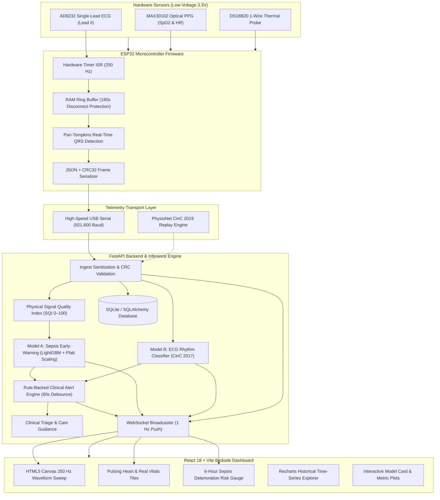

# SeptiSense System Architecture & Telemetry Pipeline

> **REGULATORY NOTICE:** Educational and research prototype. Not clinically validated. Not a substitute for medical advice.

---

## 1. High-Level Architecture Overview

SeptiSense is designed as a continuous physiological monitoring and early-warning research platform. It connects low-voltage embedded biomedical transducers to an ESP32 microcontroller, streams real-time telemetry over a high-baud USB serial link (or WiFi HTTP fallback) with CRC32 frame validation, executes machine learning inference (Model A Sepsis Early-Warning + Model B ECG Rhythm/QRS), and broadcasts 1 Hz updates over WebSockets to a multi-page React bedside dashboard.



---

## 2. Telemetry Pipeline Detailed Stages

### Stage 1: Embedded Signal Acquisition (ESP32)
1. **ECG Sampling**: An ESP32 64-bit hardware timer fires an interrupt service routine (ISR) at precisely **250 Hz** ($T_s = 4.0\text{ ms}$). ADC readings from GPIO36 (VP) are placed into a lock-free circular ring buffer.
2. **Optical Photoplethysmography (PPG)**: The MAX30102 sensor is polled via I2C at 400 kHz. Red and Infrared LEDs sample pulsatile blood flow. The AC/DC ratio of ratios is computed to determine $SpO_2$:
   $$R = \frac{\text{AC}_{\text{red}} / \text{DC}_{\text{red}}}{\text{AC}_{\text{ir}} / \text{DC}_{\text{ir}}}, \quad SpO_2 = 110 - 25 \cdot R$$
3. **Core Temperature**: A DS18B20 1-Wire probe on GPIO4 performs non-blocking temperature conversions at 12-bit resolution ($0.0625^\circ\text{C}$ granularity).
4. **Disconnect Ring Buffer**: When USB serial transmission blocks or is disconnected, an in-memory telemetry buffer retains up to **180 seconds** of data. Upon reconnection, backlogged records are flushed automatically with `buffered: true`.

---

### Stage 2: Transport & Validation
- **Framing**: Each telemetry packet is serialized as a single-line JSON string terminated by newline (`\n`).
- **Data Integrity**: An IEEE 802.3 **CRC32** checksum is appended to every line:
  ```json
  {"device_id":"esp32-01","patient_id":1,"ts_ms":1798632000000,"hr_bpm":78.0,"spo2_pct":98.0,"temp_c":37.1,"ecg":[...],"crc":2847192841}
  ```
- **Baud Rate**: Operates at **921,600 baud** to comfortably support 250 raw 16-bit ECG samples per second alongside optical, thermal, and metadata streams.
- **Serial Reconnection Worker**: A dedicated background daemon thread (`serial_service.py`) scans available `/dev/cu.*` or `/dev/ttyUSB*` ports, re-establishes dropped connections automatically, and validates each line's CRC32 prior to dispatching to the ingest pipeline.

---

### Stage 3: Ingest, Sanitization & Physical SQI Computation
1. **Physiological Sanitization**: Implausible physical values are clamped or masked:
   - Heart Rate: $[30, 220]\text{ BPM}$
   - Blood Oxygen: $[60\%, 100\%]$
   - Core Temperature: $[30.0^\circ\text{C}, 43.0^\circ\text{C}]$
2. **Physical Evidence SQI (0–100%)**:
   - **ECG SQI**: Evaluates baseline wander variance, high-frequency EMG noise ratio, ADC saturation counts, and hardware leads-off GPIO pins (`LOD+` / `LOD-`).
   - **PPG SQI**: Evaluates AC/DC optical pulsatile amplitude ratio and finger contact state.
   - **HR Agreement SQI**: Cross-correlates optical PPG pulse rate against ECG Pan-Tompkins QRS R-peak rate:
     $$\Delta_{\text{HR}} = |\text{HR}_{\text{ECG}} - \text{HR}_{\text{PPG}}|$$
     Penalties are applied if $\Delta_{\text{HR}} > 10\text{ BPM}$.
   - **Temperature SQI**: Penalizes rapid unphysiological temperature jumps ($>0.5^\circ\text{C}/\text{min}$).

---

### Stage 4: Machine Learning Inference

#### Model A: Sepsis Early-Warning Deterioration Risk
- **Formulation**: Estimates the conditional probability that a patient will experience sepsis-related clinical deterioration within the next **$H = 6\text{ hours}$**:
  $$P(\text{Deterioration in } [t, t+6] \mid \mathbf{x}_{1:t})$$
- **Feature Pipeline**: 80 vectorized, sensor-feasible features computed dynamically over strictly causal rolling windows ($1\text{h}$, $3\text{h}$, $6\text{h}$):
  - Rolling mean, min, max, standard deviation of HR, SpO2, Temp, and Respiration.
  - Linear trend differentials: $\Delta \text{HR}_{3h} = \text{HR}_t - \text{HR}_{t-3h}$.
  - Temperature-to-HR shock index proxies.
- **Model Architecture**: LightGBM Gradient Boosted Decision Trees calibrated with **Platt Sigmoid Scaling**:
  $$P(y=1 \mid f(\mathbf{x})) = \frac{1}{1 + \exp(A \cdot f(\mathbf{x}) + B)}$$
- **Validation**: Evaluated using **Patient-Level GroupShuffleSplit** on 3,000 patient records (Hospital Systems A & B):
  - Held-out AUROC: **0.7205**
  - Held-out AUPRC: **0.0423** (Baseline prevalence 1.8%)
  - Brier Score: **0.0085**
  - Sensitivity: **80.26%** at decision threshold $\tau = 0.0077$
  - Specificity: **45.66%**

#### Model B: Real-Time ECG Rhythm Classifier & QRS Benchmark
- **Pan-Tompkins QRS Detector**:
  - Validated against gold-standard MIT-BIH Arrhythmia Database expert annotations (`mitdb` 14 records).
  - Sensitivity: **98.68%** (2,161 / 2,190 true beats detected within $\pm 75\text{ ms}$ tolerance).
  - Positive Predictive Value (PPV): **99.68%**.
- **CinC 2017 Multi-Class Rhythm Classifier**:
  - Classifies 250 Hz single-lead ECG segments into: Normal Rhythm, Atrial Fibrillation (AF), Other Arrhythmia, or Noisy Signal.
  - Overall 4-class Accuracy: **74.17%**, Macro F1: **0.6413**.

---

### Stage 5: Alert Engine & Clinical Care Guidance
1. **Clinical Threshold Checks**: Evaluates physiological boundaries (Bradycardia $<50$, Tachycardia $>120$, Hypoxia $<90\%$, Fever $>38.5^\circ\text{C}$, Sepsis Risk $\ge 40\%$).
2. **Debounce Cache**: Prevents alarm fatigue by enforcing a **60-second cooldown window** per patient-parameter pair unless severity escalates to critical.
3. **Care Guidance Triage**: Rule-backed algorithmic triage mapping patient deterioration patterns into three actionable tiers:
   - **Tier 1 (Routine Check-in)**: Normal physiological status, low predictive risk.
   - **Tier 2 (See a Doctor Within 24–48 Hours)**: Borderline vitals or moderate predictive risk escalation.
   - **Tier 3 (Seek Urgent Care Now)**: High sepsis deterioration risk ($\ge 40\%$), critical hypoxia, or sustained tachycardia.

---

### Stage 6: Real-Time WebSocket & Bedside Dashboard
- **WebSocket Endpoint**: `WS /ws/live/{patient_id}` pushes 1 Hz telemetry payloads including:
  - Latest vitals (`hr_bpm`, `spo2_pct`, `temp_c`, `resp_rate`)
  - Real-time SQI breakdown & active reason list
  - Sepsis 6h deterioration risk probability & top feature drivers
  - ECG rhythm label & recent 50-sample waveform snippet
- **Client Canvas Waveform**: Renders 250 Hz Lead II ECG samples on an HTML5 Canvas using a 50px/10px medical grid, 1 mV calibration pulse, and sweep phosphor effect.
- **Audio Alarm Beeper**: Synthesizes standard clinical beeping tones using the browser Web Audio API when unacknowledged critical alerts are active.
